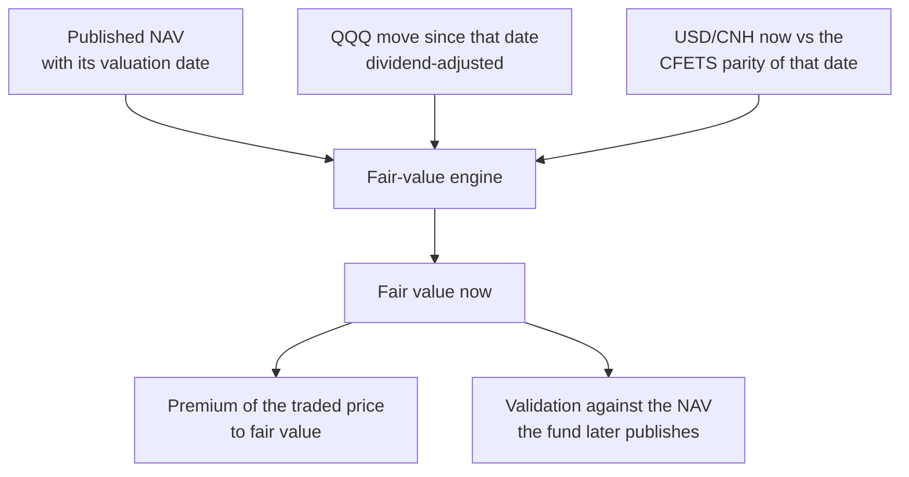
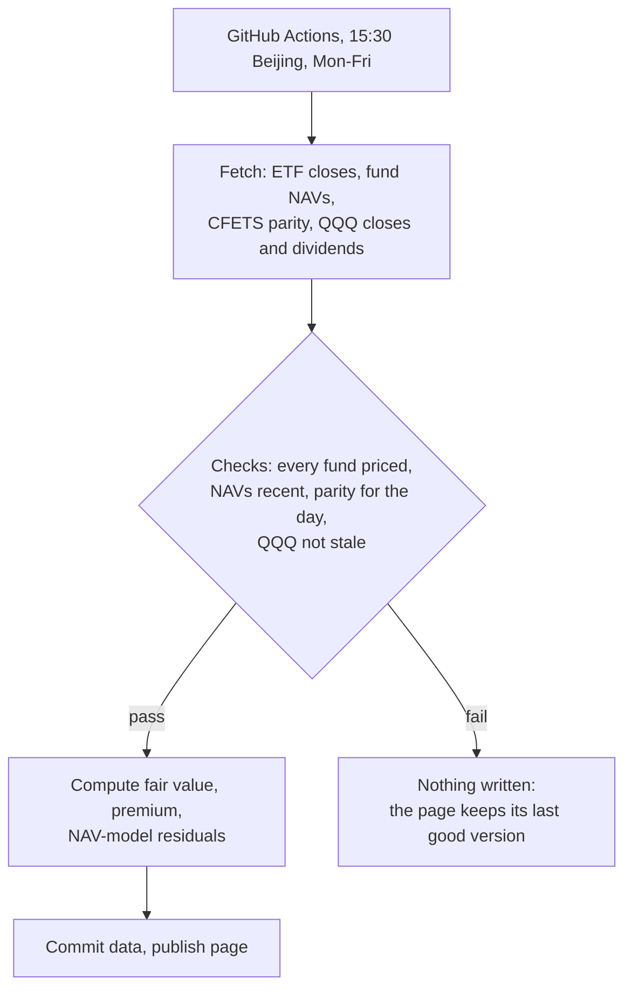

# qdii-fair-value-engine

**A fair value the exchange doesn't publish, rebuilt for China-listed NASDAQ-100 ETFs, plus an interactive dashboard of each fund's premium to it.**

**[Open the dashboard →](https://leorich-max.github.io/qdii-fair-value-engine/)** (public market data, updated every trading day)

## The problem

China-listed QDII ETFs on the NASDAQ-100 trade during Shanghai/Shenzhen hours, while their US underlying is closed. The exchange's indicative value (IOPV) carries the previous US close and does not move during the A-share session, so it cannot tell you whether an ETF is trading above or below what its holdings are worth right now.

The engine rebuilds that value from public inputs:

```text
FV(t) = NAV(D) × QQQ(t) / QQQ_reference(D) × USDCNH(t) / CFETS_parity(D)
```

`D` is the NAV's valuation date (not the day it was retrieved), `QQQ_reference(D)` the dividend-adjusted close for that US session, and `CFETS_parity(D)` the central parity the fund used to convert it. The premium is then `ln(price / FV)`.



## Validation

The same conventions are checked against what the funds actually publish. For each pair of consecutive NAVs, the NAV return is compared with QQQ's total return times the parity move over the same valuation dates. Since March 2025 the residual standard deviation is about **4–5 bp for 11 of the 12 funds** (mean absolute error about 3 bp), and the dashboard shows each fund's figure. An earlier study on one fund found 3.2 bp over 151 days. One fund (513300) is a clear outlier at about 14 bp, and the dashboard shows it as is. This measures how well valuation-date and currency conventions explain published NAVs; it is not a pricing error at any moment and not a trading result. [Derivation and validation scope](docs/fair_value_derivation.md)

## The dashboard

A static page (no server, no install), rebuilt every trading day from public data:

- **Price vs fair value** for any of the 12 funds and any date range since March 2025;
- **Premium to fair value** in basis points, with a shared cursor;
- **All funds on one date**, so the premium cross-section is visible at a glance;
- **NAV used and validation**: which NAV valuation date each day relies on, and each fund's NAV-model residual;
- **A calculator**: enter a NAV, QQQ and FX levels and a price, and get the fair value, the premium and how much of the move came from QQQ vs FX.

What it deliberately does not claim: QQQ is its last US close, so overnight QQQ and Nasdaq-futures moves during Asian hours are not included. FX is the day's CFETS parity, not market USD/CNH. The source gives each NAV's valuation date but not its publication time; the pipeline records when it first sees each NAV from now on.

## The daily pipeline



| Input | Source | Fallback |
|---|---|---|
| ETF daily closes | Tencent | — |
| Fund NAV and valuation date | EastMoney | — |
| USD/CNY central parity | SAFE | chinamoney (CFETS) |
| QQQ closes and dividends | Yahoo | Nasdaq |

Sources throttle bursts, so the NAV and parity histories are kept in `data/live/` and only recent rows are fetched each day. `nav_history.csv` records when each NAV was first seen; rows filled in by the one-off backfill are marked `backfill`, not given a date they were never observed on.

```bash
pip install -e ".[dev]"
python -m qdii_fve.live.update      # fetch, check, rebuild app/data.js (writes nothing if a check fails)
# then open app/index.html in a browser
```

## The code

| Module | What it does |
|---|---|
| `qdii_fve.fair_value.reconstruct` | roll a NAV forward to a fair value; validation residuals against the next NAV |
| `qdii_fve.fair_value.nav` | NAV vintages: which valuation date a value belongs to |
| `qdii_fve.fair_value.premium` | simple, log and basis-point premiums for one point, a series or a panel |
| `qdii_fve.live` | daily pipeline: public-data fetchers, the dated fair-value model, checks and fail-safe update |
| `qdii_fve.dashboard` | the same page payload from the synthetic sample, for offline previews and tests |
| `qdii_fve.synthetic` | deterministic synthetic sample (12 anonymised funds) |

[Notebook 01](notebooks/01_fair_value_engine.ipynb) walks through the reconstruction and validation on the synthetic sample.

## Quality

Tests cover the fair-value maths, NAV vintages and premiums; every data-source parser (on captured payload shapes, offline); the dated model rules with hand-computed cases (last US close before the day, US holidays, missing inputs giving gaps, dividends in the total-return index); NAV first-seen and revision tracking; the fail-safe (a failed fetch or check writes nothing); and the JavaScript calculator, run in Node against the Python function. CI runs `ruff`, `black --check` and `pytest` on every push; the tests never touch the network.

```bash
pytest
```

## Data

The dashboard uses public data from the sources above; check their terms before reusing it. `data/sample/` is **synthetic**, generated from a fixed seed by `scripts/make_synthetic_sample.py`, and drives the notebook and the offline tests. Nothing here is investment advice.

[MIT licence](LICENSE)
