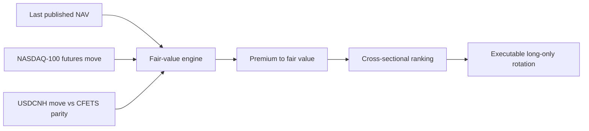

# qdii-fair-value-engine

Reconstructing a fair value the exchange doesn't publish — and testing whether it can be traded.

## Summary

This project reconstructs the real-time fair value of China-listed NASDAQ-100 QDII ETFs during the hours their US underlying is closed — a value the exchange does not provide — and studies whether the resulting cross-sectional premium deviations can be captured by an executable, long-only rotation. The emphasis is on realistic execution, microstructure validation, capacity, and overfitting control rather than maximising a backtest. Unlike a US ETF, a QDII ETF keeps trading while its underlying market is shut, so the exchange's intraday IOPV (Indicative Optimized Portfolio Value) is stale and the premium cannot be read from it directly. Reconstructing that fair value is the core contribution; everything downstream depends on it.

> Research artifact, not a product. It documents the *methods* behind a live paper strategy. No real money is involved and no vendor data is redistributed; see [what is withheld](#what-is-withheld-and-why) and [limitations](#limitations).

## Key results

| Contribution | Result |
|---|---|
| Fair-value reconstruction | NAV-prediction error of **3.2 bp** vs realised NAV (corr 0.9975) |
| Executable strategy | **+7.9%/yr** excess, after realistic bounce-free execution |
| Microstructure validation | Bid-ask bounce accounted for **~half** of a competing signal's apparent alpha |

<sub>Backtested on ~2 years of licensed data (not redistributed); excess is versus the 12-fund equal-weight basket, not QQQ; paper-traded, never real money. Full labelled table and [limitations](#limitations) below.</sub>

## How the fair value is built



The exchange IOPV carries the prior US close and does not move during A-share hours. The engine instead rolls the last published NAV forward by the NASDAQ-100 futures move and the USDCNH move against the CFETS central parity, giving a live fair value validated to ~3 bp against the NAV the fund later publishes. Full derivation: [`docs/fair_value_derivation.md`](docs/fair_value_derivation.md).

## Research highlight — separating edge from noise

A competing intraday signal looked like +16.0%/yr. Filled the way it could actually be traded — next session, on the opponent side of the spread — it left +7.9%/yr. About half of its apparent alpha was **bid-ask bounce, not edge**: the signal kept selecting funds that looked cheap only because of a downward bounce that reverted the next bar. Reporting the executable number instead of the flattering one is the clearest example of how this research is done.

→ [`notebooks/02_bounce_decomposition.ipynb`](notebooks/02_bounce_decomposition.ipynb)

## Research

1. **Fair value** — `FV = NAV × (index move) × (USDCNH move vs CFETS parity)`, rolled forward from the last published NAV (the IOPV is stale intraday).
2. **Signal** — a cross-sectional, mean-reverting premium deviation: how cheap a fund is versus the basket and its own trailing norm. Hold the cheapest, rotate past a threshold. The construction is documented; the calibrated constants are not.
3. **Costs** — a Corwin-Schultz half-spread per leg, shown as a *ladder* (gross → realistic → conservative) rather than a single guess, so the reader sees where the edge survives.
4. **Capacity** — Kyle's λ from signed order flow, λ ≈ 0.5–3.9 bp per 1M CNY across funds; bounded by the thin names the rotation must sometimes hold, capacity is single-digit to low-double-digit millions of CNY.

## Validation and overfitting control

- **Fair value** is validated against the NAV the fund later publishes — a 3.2 bp residual standard deviation, not an unfalsifiable claim.
- **Execution** is validated by the bounce decomposition above: the executable fill, not the same-bar fill, is the reported number.
- **Universe** — the wider 12-fund universe was kept over an in-sample-optimal 7-fund subset (Sharpe 1.16 vs 1.56) because the extra funds carried equal signal quality (information coefficient +0.33 vs +0.32). Parameter sweeps in the deployment's own frame rejected higher-scoring cells that were knife-edge rather than robust.

## Execution and engineering

A live stack (patterns, not the production system) handles minute-bar signal generation, quote polling, trading-halt (临时停牌) handling, spread and price-limit guards, and a daily reconciliation auditor: [`docs/architecture.md`](docs/architecture.md). Orders are placed at opponent prices, matching the bounce-free fill the backtest is validated against.

Engineering: type hints and docstrings throughout, deterministic seeds, 52 `pytest` tests (with coverage of the fair-value engine and cost model in particular), `ruff` + `black`, and GitHub Actions CI running lint and tests on every push.

## Notebooks

Each runs top-to-bottom on the synthetic sample and tells one story.

- [01 · Fair-value engine](notebooks/01_fair_value_engine.ipynb) — reconstruct fair value, form the premium, validate against realised NAV.
- [02 · Bounce decomposition](notebooks/02_bounce_decomposition.ipynb) — split a signal's apparent edge into bounce vs executable alpha.
- [03 · Universe selection](notebooks/03_universe_selection_overfitting.ipynb) — why the wider, lower-Sharpe universe is the disciplined choice.

## Full results

Excess return versus the 12-fund equal-weight basket (not QQQ), ~2 years. Each figure is labelled; exact values were computed on licensed data not redistributed here, so the notebooks reproduce the *method* on synthetic data whose outputs differ.

| What | Figure | Status | Where |
|---|---|---|---|
| Fair-value reconstruction error vs realised NAV | residual std 3.2 bp (MAE 2.5 bp, corr 0.9975) | validated | [NB01](notebooks/01_fair_value_engine.ipynb) |
| Daily laggard rotation — excess @ 12 bp/swap | +6.0%/yr, Sharpe 1.16, ~11 trades/yr, maxDD −3.1% | backtested (~2 yr) | [docs](docs/fair_value_derivation.md) |
| Intraday snapback — executable estimate | +7.9%/yr (next-session, Corwin-Schultz fills) | backtested · paper-only | [NB02](notebooks/02_bounce_decomposition.ipynb) |
| Bid-ask bounce decomposition | +16.0% → +7.9%/yr (~half the apparent edge was bounce) | backtested | [NB02](notebooks/02_bounce_decomposition.ipynb) |
| Universe choice (overfitting rejection) | 12-fund Sharpe 1.16 over in-sample 7-fund 1.56; IC +0.33 vs +0.32 | backtested | [NB03](notebooks/03_universe_selection_overfitting.ipynb) |
| Capacity (Kyle's λ) | λ ≈ 0.5–3.9 bp per 1M CNY; capacity ~single-digit to ~15M CNY | backtested | [`src`](src/qdii_fve/capacity) |

## Limitations

The full list is in [LIMITATIONS.md](LIMITATIONS.md). In brief: the ~2-year sample carried a premium-expansion tailwind, so absolute returns are not a QQQ substitute and the edge is quoted as excess vs the basket; sub-period splits are sub-periods of one sample, not independent regimes; every figure is backtested (a short forward paper record exists but is too brief to headline); capacity is low and decays with size; and an out-of-sample walk-forward is noted as the next step, not yet run.

## What is withheld, and why

To keep the repository reproducible while protecting a low-capacity research idea, only the calibrated constants are omitted: entry/exit thresholds, the norm lookback, sizing coefficients, and the specific ETF identifiers and weights (the code uses anonymised `ETF_01…12`), plus any credentials. All modelling methodology, validation procedures, and software architecture are documented in full. The omitted constants load from a `config.yaml` that is gitignored; [`config.example.yaml`](config.example.yaml) ships plausible placeholder values.

## Skills utilised in this project

- Fair-value modelling and statistical validation against realised outcomes
- Financial market microstructure (bid-ask bounce, spread estimation)
- Backtesting with realistic, executable fill and cost assumptions
- Capacity / price-impact analysis (Kyle's λ)
- Overfitting control and out-of-sample discipline
- Research reproducibility (synthetic data, deterministic seeds)
- Python package design, testing, and continuous integration

## Reproducing

```bash
pip install -e ".[dev,notebooks]"
python scripts/make_synthetic_sample.py     # deterministic synthetic sample
jupyter lab notebooks/                        # run any notebook top-to-bottom
```

The committed data under [`data/sample/`](data/sample) is synthetic and clearly labelled; it reproduces the pipeline mechanics, not the real figures. To reproduce those, point the loaders at your own feed (fund NAVs, exchange quotes, NASDAQ-100 futures / dividend-adjusted QQQ, and CFETS central parity — all public), keeping the sample's column schema. Exact reproduction also needs the same universe and window, so the method and ballpark reproduce, not bit-exact figures.

## Repository layout

```
docs/            fair-value derivation, live-stack architecture
notebooks/       01 fair value · 02 bounce · 03 universe
src/qdii_fve/    fair_value · costs · backtest · capacity · execution · config
tests/           unit tests
data/sample/     synthetic sample only (no vendor data)
config.example.yaml   placeholder parameters (real config.yaml is gitignored)
```

## License

[MIT](LICENSE). The code is illustrative architecture; the strategy itself is not open-sourced.
