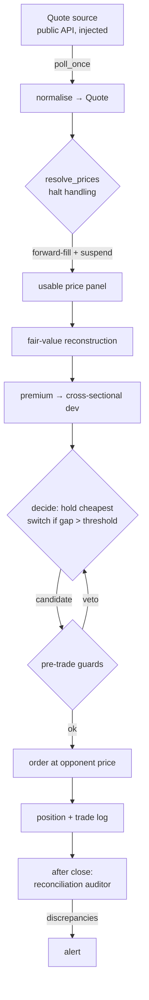

# Live-stack architecture

This documents the *design* of the execution stack and the patterns that make it
robust. It is representative architecture, not the full production system: there
are **no broker credentials, no account identifiers, and no calibrated
parameters** here. The code lives in
[`src/qdii_fve/execution/`](../src/qdii_fve/execution).

## Data flow

## Components

### 1. Quote polling — [`quotes.py`](../src/qdii_fve/execution/quotes.py)
The loop polls a **injected** `fetch_fn` and normalises each snapshot into a
`Quote` (last, bid1, ask1, status, price limits). Injecting the data source keeps
the loop provider-agnostic and testable, and keeps any real endpoint or key out
of the repository.

### 2. Trading-halt handling — [`halts.py`](../src/qdii_fve/execution/halts.py)
High-premium NASDAQ-100 QDII ETFs are routinely **临时停牌 (temporarily halted)**
for the first hour at the open to cool the premium. The feed then returns no
price, which looks exactly like a data glitch but is not. Correct handling:

- **forward-fill** the halted fund from its last good price (do not retry the
  feed — a halted fund has no price from any source);
- **mark it suspended** and **exclude it from candidates** (you cannot rotate
  into a halted fund);
- **hold through** if the *held* fund is the one halted;
- require a **floor of live funds** before trusting the cross-section at all.

This was learned from a live session: treating an open-hour halt as a feed bug
and retrying is the wrong instinct.

### 3. Pre-trade guards — [`guards.py`](../src/qdii_fve/execution/guards.py)
Every order passes cheap vetoes first: a valid book must exist, status must be
trading, the quoted spread must be inside a ceiling (crossing a wide spread gives
up the edge), and the price must not be pinned at the daily limit (where a
marketable order can hang or fill far away).

### 4. Reconciliation auditor — [`auditor.py`](../src/qdii_fve/execution/auditor.py)
After each session the deployed book is reconciled against an independent replay
of the same signal: intended vs actual holding, each logged decision vs a fresh
re-derivation, and position-weight drift against target. Silent divergence
between *intent* and *fills* is the failure mode this catches; it reports
discrepancies rather than raising, so one bad field never halts the audit.

## Execution price

Orders are placed at the **opponent side** (buy the ask, sell the bid) with a
protective limit, i.e. marketable-limit orders. This is deliberate: it is the
bounce-free fill assumption the backtest is validated against (see the bounce
decomposition), so live execution and the backtest agree on how fills are priced.

## Scheduling and reliability

The runner is launched by the OS scheduler once per trading day and evaluates the
signal on a minute cadence through the session. Two reliability details matter in
practice:

- **Catch-up on missed sessions.** If a launch is missed, the next run detects
  the gap and reconstructs state rather than assuming continuity.
- **Wake vs. sleep.** A user-space timer cannot wake a sleeping machine; only the
  OS scheduler's wake trigger can, and only for the trigger itself. The trigger
  is therefore placed when the host is reliably awake, not left to a mid-session
  self-wake.

## What is deliberately absent

Broker API wiring, credentials, order-routing specifics, and every calibrated
parameter (thresholds, lookbacks, sizing). Those live outside the repository or
in a gitignored config. The intent here is to show the *shape* of a disciplined
live stack, not to hand over a runnable trading system.
